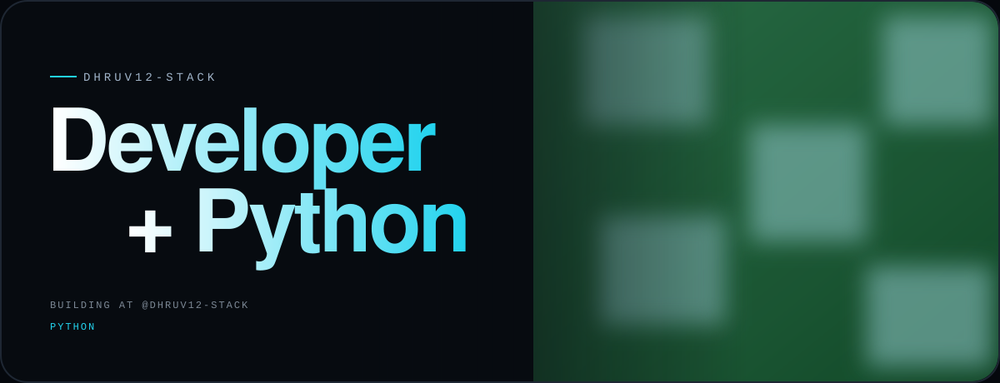
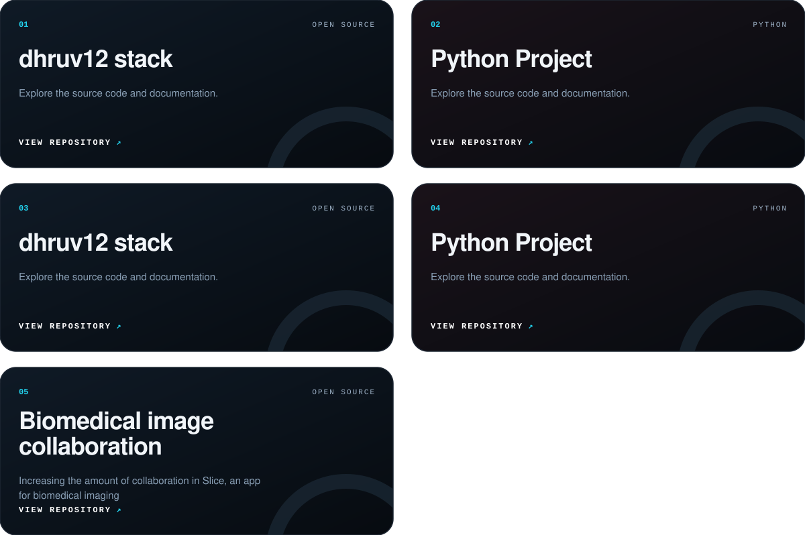
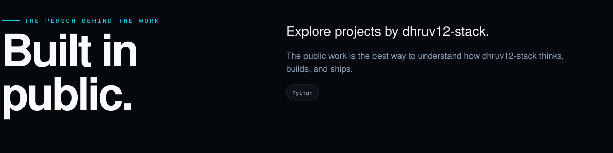
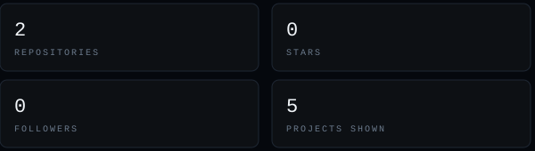
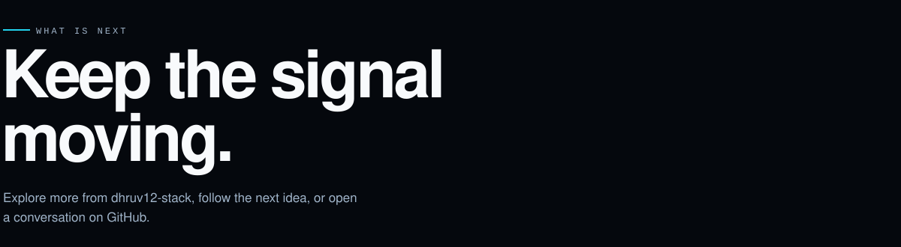

<!-- Profile README for github.com/dhruv12-stack  (repo name must be: dhruv12-stack) -->

&nbsp;
**D H R U V 1 2 - S T A C K**

<a href="#selected-work">WORK</a> &nbsp;·&nbsp; <a href="#built-in-public">ABOUT</a> &nbsp;·&nbsp; <a href="#keep-the-signal-moving">CONTACT</a>

 

  

  
  

 

## Selected work.

> A living selection of repositories, experiments, and shipped ideas. Follow the signal back to the source.

 

## Built in public.

  

 

## Keep the signal moving.

  

---

<code>© 2026 dhruv12-stack · Built from public GitHub work</code>